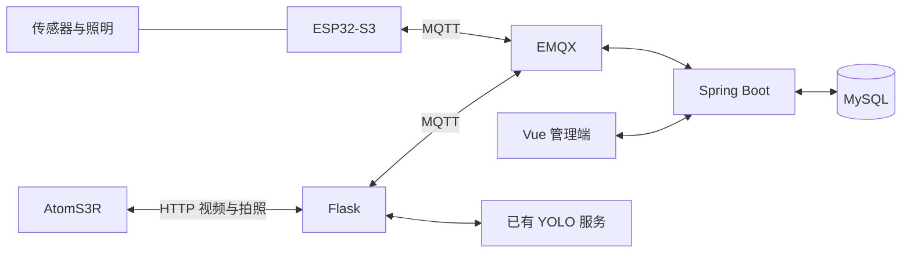

# ESP32-S3 / AtomS3R 智慧灯杆系统

物联网比赛项目：将环境与电参量采集、自动照明、远程控制、摄像头视频与后台管理集成在同一系统中。

本仓库从本地工作副本恢复，包含恢复时尚未提交的控制器与摄像头修改。恢复副本已移除实际 Wi-Fi/数据库密码、历史用户与运行记录、抓拍照片、编译产物和模型权重；本地原工程不受影响。

## 功能与技术

| 模块 | 实现 |
| --- | --- |
| 灯杆控制器 | ESP32-S3，DHT11、光敏、INA219，继电器照明控制 |
| 设备通信 | MQTT 环境/电参量上报、灯状态与控制指令 |
| 摄像头 | AtomS3R，视频流、拍照与图片上传 |
| 管理平台 | RuoYi 衍生的 Spring Boot / Vue / MySQL 应用，设备、灯杆、曲线与告警 |
| 图像服务 | Flask 视频/抓拍服务，对接已有 YOLO 推理服务 |



## 目录

```text
arduino_stream/esp32_s3_wroom/   灯杆控制器固件
arduino_stream/atoms3r_camera/   摄像头固件
arduino_stream/server/          Flask 服务及模板
vm_deploy/                     虚拟机图像服务部署脚本
iotlight-admin/                Spring Boot 入口与配置
iotlight-common/               公共代码
iotlight-framework/            框架与安全模块
iotlight-system/               管理与业务实现
iotlight-generator/            代码生成模块
iotlight-quartz/               定时任务模块
start-vue/                     有实际 src/ 的 Vue 前端工程
sql/data.sql                   表结构、框架元数据与本地管理员占位记录
```

`build/` 与 `start-vue/build/` 是前端构建脚本，属于源码；`target/`、`node_modules/` 和运行数据不随仓库发布。

## 本地配置与运行

### 1. 数据库与管理员

准备 MySQL、Redis、MQTT broker，以及 Maven 和与 `pom.xml` 匹配的 JDK。原工程声明的 Java 版本为 17；仓库保留原依赖版本，本次恢复没有进行依赖升级或完整后端构建认证。

创建 `iot-light` 数据库并导入 `sql/data.sql`。公开 SQL 不含原用户、登录记录、操作日志、抓拍记录和遥测历史。`admin` 仅有 `CHANGE_ME_BCRYPT_HASH` 占位值，需要先用本地工具生成自己的 BCrypt 密码哈希才能登录。

随后在本地数据库执行，替换为自己生成的值：

```sql
UPDATE sys_user SET password = '<YOUR_BCRYPT_HASH>' WHERE user_id = 1;
```

不要把生成的密码、哈希或私有配置提交回来。通过管理页面建立自己的演示灯杆与设备。

### 2. 后端与前端

在本地设置 `DB_PASSWORD`、`TOKEN_SECRET` 和 `DRUID_PASSWORD`，再按实际环境调整 `application-druid.yml` 的主机和用户名。`TOKEN_SECRET` 应为本地生成的随机值。

```powershell
$env:DB_PASSWORD = '<your-local-database-password>'
$env:TOKEN_SECRET = '<your-random-local-signing-secret>'
$env:DRUID_PASSWORD = '<your-local-console-password>'
mvn -pl iotlight-admin -am clean package -DskipTests
java -jar iotlight-admin/target/iotlight-admin.jar --server.port=8081
```

在另一个终端启动前端：

```powershell
cd start-vue
npm ci
npm run dev -- --port 8082
```

前端现有代理目标为 `http://localhost:8081`。如果调整后端端口，也要同步修改 `start-vue/vue.config.js`。旧启动脚本保留的是本机路径示例，可按安装位置修改。

### 3. 固件与图像服务

1. 在 Arduino IDE 中打开对应 `.ino`，根据项目 include 安装匹配的 ESP32、摄像头与传感器依赖。
2. 将 `YOUR_WIFI_SSID`、`YOUR_WIFI_PASSWORD` 和服务器地址改为本地配置；先单独检查供电、共地和传感器，再下载固件。
3. 控制器示例以 `LP001` 标识灯杆，需与平台设备配置保持一致。MQTT 主题定义以现有固件和后端实现为准。
4. 图像服务可使用 `vm_deploy/`，依赖与启动方式见其中说明。`yolo11n.pt` 未随本次恢复发布，需要自行从模型上游获取并放在 `vm_deploy/` 下。
5. 摄像头的 stream/capture、Flask、MQTT 与后端地址需要在同一可达网络中配置。

## 演示建议

先演示传感器变化和自动照明，再演示后台控制与状态更新，最后展示视频和拍照。界面、设备回执和实际执行器分别确认，不以网页按钮状态代替实物反馈。

现有识别能力来自已集成的模型服务，不是自行训练基础模型。光敏换算、演示数据和历史调试记录不作为测量精度证明。公开副本是源码恢复，不代表本次重新完成了实机验收。

## 来源与许可

平台基于 RuoYi-Vue 及现有开源依赖进行适配与业务集成，保留原 `LICENSE` 和源码中的上游声明。第三方模型与硬件库按各自许可使用；本仓库不将其宣称为个人原创。
